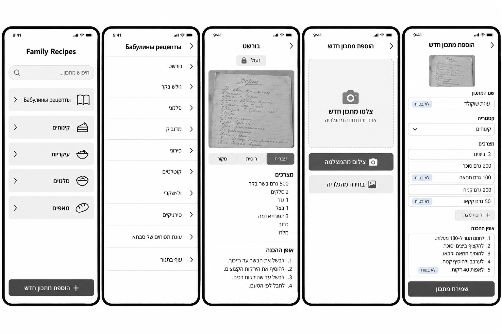
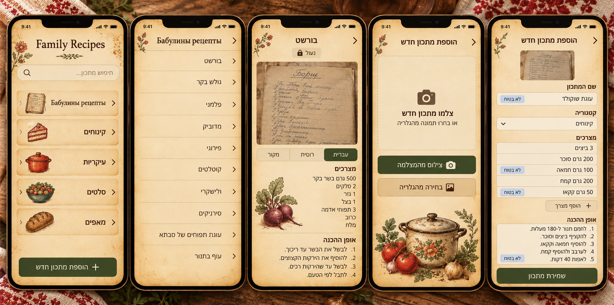
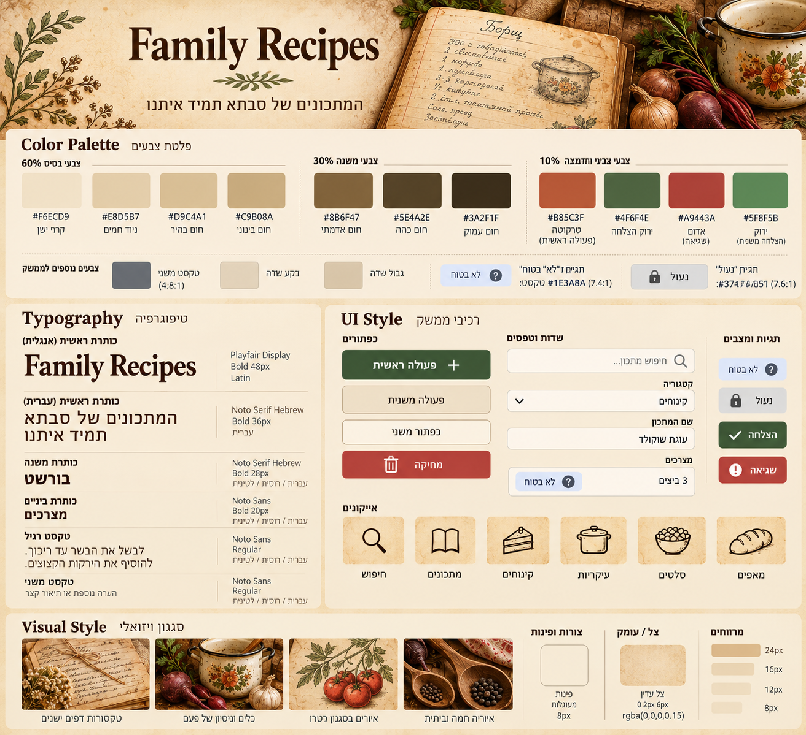

# DESIGN: Family Recipes

מבוסס על `product-10-definitions.md`, `PRD.md` ושלוש התמונות. הסמכות לפרטים חזותיים היא התמונות. כשהתמונות סותרות זו את זו או את ה-PRD, ההחלטה רשומה בסעיף "הערות והחלטות" בסוף. קודי HEX מודפסים ב-Style Guide הם הסמכות לצבעים, וערכים שנדגמו מהתמונות מסומנים "להערכה".

## תמונות הייחוס

## 1. Screens

### המסך הראשי
- **המטרה:** נקודת כניסה: למצוא מתכון בחיפוש או לבחור קטגוריה, ולהתחיל הוספת מתכון.
- **מה יש במסך:**
  - כותרת "Family Recipes" עם ענף קישוט מתחתיה.
  - שורת חיפוש עם אייקון זכוכית מגדלת וטקסט "...חיפוש מתכון".
  - רשימת קטגוריות ככרטיסים, בסדר הזה: "Бабулины рецепты" ראשונה, ואחריה קינוחים, עיקריות, סלטים ומאפים. בכל כרטיס איור או אייקון בצד ההתחלה (ימין), שם הקטגוריה, וחץ.
  - כפתור ראשי ירוק בתחתית: "הוספת מתכון חדש" עם סימן +.
- **מה קורה במסך:**
  - לחיצה על קטגוריה פותחת את רשימת המתכונים שלה.
  - הקלדה בחיפוש מסננת מתכונים לפי שם. חיפוש בלי תוצאות מציג "לא נמצאו מתכונים".
  - לחיצה על הכפתור הראשי פותחת את מסך ההוספה.
  - בכניסה הראשונה במכשיר, או כשהקוד חסר או לא תקף, מוצג במקום המסך מצב "נדרש קוד" (ראו הערות והחלטות).

### רשימת מתכונים בתוך קטגוריה
- **המטרה:** להציג את כל המתכונים בקטגוריה ולבחור אחד.
- **מה יש במסך:**
  - כותרת עם שם הקטגוריה, וחץ חזרה בצד ימין.
  - רשימה אחת של מתכונים. כל שורה היא שם המתכון וחץ. אין תמונות ממוזערות ואין חלוקה נוספת.
  - ענף קישוט בפינה, בשוליים.
- **מה קורה במסך:** לחיצה על שורה פותחת את מסך המתכון. חץ החזרה מחזיר למסך הראשי.

### מסך מתכון
- **המטרה:** לקרוא את המתכון תוך כדי בישול.
- **מה יש במסך:**
  - כותרת עם שם המתכון, וחץ חזרה בצד ימין.
  - תגית "נעול" עם אייקון מנעול מתחת לכותרת, במתכוני סבתא בלבד.
  - צילום הדף המקורי, בלי כפתור הגדלה.
  - שלוש לשוניות: מקור, רוסית, עברית. העברית נבחרת כברירת מחדל.
  - סעיף "מצרכים" (רשימה) וסעיף "אופן ההכנה" (רשימה ממוספרת), בשפה שנבחרה.
  - איור קישוט בשוליים בלבד, לא מעל הטקסט.
- **מה קורה במסך:**
  - המסך נשאר דולק כל עוד המתכון פתוח. אין כפתור לכך ואין חיווי.
  - החלפת לשונית מחליפה את הטקסט, והצילום נשאר.
  - מתכון נעול לא מציג עריכה או מחיקה.

### הוספת מתכון בצילום
- **המטרה:** להכניס מתכון חדש בצילום, לבדוק את מה שהמודל קרא ולשמור.
- **מה יש במסך:** המסך הזה פועל בשני שלבים.
  - **שלב 1, העלאה:** חץ חזרה וכותרת "הוספת מתכון חדש"; מסגרת מקווקוות עם אייקון מצלמה, "צלמו מתכון חדש" ו"או בחרו תמונה מהגלריה"; כפתור ראשי ירוק "צילום מהמצלמה"; כפתור משני בז' "בחירה מהגלריה".
  - **שלב 2, טופס בדיקה:** הצילום שהועלה, קטן, בראש הטופס; שלוש לשוניות (מקור, רוסית, עברית) כמו במסך המתכון; שדה "שם המתכון"; רשימה נפתחת "קטגוריה"; "מצרכים" כשורות עם שדה לכל מצרך, ותגית "לא בטוח" עם סימן שאלה ליד שורה שהמודל לא קרא בבירור; כפתור משני "הוסף מצרך"; "אופן ההכנה" כרשימה ממוספרת, עם תגית "לא בטוח" ליד שלב לא ברור; כפתור ראשי ירוק "שמירת מתכון" בתחתית.
- **מה קורה במסך:**
  - המשתמשת מצלמת או בוחרת תמונה, והאפליקציה קוראת ומתרגמת. הטופס נפתח עם התוצאה.
  - המשתמשת מתקנת כל שדה בכל לשונית, מסירה תגית "לא בטוח" כשאישרה את הערך, בוחרת קטגוריה ושומרת. שום דבר לא נשמר לפני לחיצה על "שמירת מתכון".
  - הרשימה הנפתחת לא כוללת את "Бабулины рецепты".
  - אם התמונה לא קריאה: ההודעה "לא הצלחנו לקרוא את התמונה. צלמו שוב." בתגית שגיאה, והמשתמשת חוזרת לשלב 1.
  - אם שירות ה-AI לא זמין: "שירות הקריאה לא זמין כרגע. נסו שוב מאוחר יותר.", והצילום נשאר.

### ניווט בין המסכים
- המסך הראשי הוא נקודת המוצא.
- מסך ראשי, קטגוריה (או חיפוש), מתכון. חץ חזרה מחזיר צעד אחד אחורה.
- מסך ראשי, הוספת מתכון, שלב 1, שלב 2, שמירה. אחרי שמירה המשתמשת מגיעה לרשימת הקטגוריה שבה נשמר המתכון (הנחה, ראו הערות).
- חץ החזרה תמיד בצד ימין ומצביע ימינה.
- אין תפריט תחתון, אין תפריט צד ואין מסך כניסה.

## 2. Style Guide

### צבעים
קודי HEX מודפסים ב-`style-guide.png`.

**60% צבעי בסיס (רקעים):**
- `#F6ECD9` דף ישן
- `#E8D5B7` נייר חמים
- `#D9C4A1` חום בהיר
- `#C9B08A` חום בינוני

**30% צבעי משנה:**
- `#8B6F47` חום אדמתי
- `#5E4A2E` חום כהה
- `#3A2F1F` חום עמוק (טקסט ראשי)

**10% צבעי הדגשה:**
- `#4F6F4E` ירוק הצלחה. משמש גם לפעולה הראשית (הוחלט).
- `#B85C3F` טרקוטה, הדגשה בלבד.
- `#A9443A` אדום (שגיאה).
- `#5F8F5B` ירוק משני (הצלחה משנית).

**צבעים נוספים לממשק:**
- טקסט משני: להערכה `#686C71`, כ-4.8:1 לפי Style Guide.
- תגית "לא בטוח": טקסט `#1E3A8A` (7.4:1), רקע להערכה `#DDE6F7`.
- תגית "נעול": טקסט `#374151` (7.6:1, הקוד מטושטש בתמונה), רקע להערכה `#DBDBDA`.
- רקע שדה: להערכה `#E1D1B9`. גבול שדה: להערכה `#D7C4A8`.

**ניגודיות:** יעד 4.5:1 לפחות. טקסט לבן על `#4F6F4E` כ-5.6:1, ועל `#A9443A` כ-5.9:1, לפי חישוב. מצב לא מועבר בצבע בלבד: ליד כל תגית יש מילה ואייקון.

### גופנים
- **כותרת ראשית באנגלית:** Playfair Display, Bold, 48px, לטינית. "Family Recipes" בלבד.
- **כותרת ראשית בעברית:** Noto Serif Hebrew, Bold, 36px.
- **כותרת משנה, שם מתכון:** Noto Serif Hebrew, Bold, 28px (גם לטינית ורוסית לפי Style Guide).
- **כותרת ביניים** ("מצרכים", "אופן ההכנה"): Noto Sans, Bold, 20px.
- **טקסט רגיל:** Noto Sans, Regular, 16px.
- **טקסט משני:** Noto Sans, Regular, 12px.
- **כיסוי שפות:** עברית, לטינית ורוסית. כיסוי הגופנים לעברית ולקירילית יאומת ב-Google Fonts לפני הבנייה. אם לגופן אין עברית, יוגדר גופן גיבוי עם עברית (כמו Noto Sans Hebrew).

### כפתורים ורכיבים
- **כפתור ראשי:** ירוק `#4F6F4E`, טקסט לבן, אייקון (+ או מצלמה). "הוספת מתכון חדש", "צילום מהמצלמה", "שמירת מתכון".
- **כפתור משני:** רקע בז', טקסט חום כהה. "בחירה מהגלריה", "הוסף מצרך".
- **כפתור קונטור:** מסגרת בלי מילוי, קיים ב-Style Guide.
- **כפתור מחיקה:** אדום `#A9443A`, טקסט לבן, אייקון פח. מופיע ב-Style Guide, לא במסכי ה-MVP (מחיקה היא Should).
- **שדות:** תווית מעל השדה, רקע בהיר, גבול דק. שדה חיפוש עם אייקון זכוכית מגדלת. רשימה נפתחת עם חץ.
- **כרטיסי קטגוריה:** כרטיס עם איור או אייקון, שם וחץ.
- **רשימת מתכונים:** שורות עם קו מפריד, שם וחץ.
- **לשוניות:** שלוש לשוניות, הנבחרת בירוק עם טקסט לבן.
- **תגיות:** "לא בטוח" (סימן שאלה), "נעול" (מנעול), "הצלחה" (וי, ירוק כהה), "שגיאה" (סימן קריאה, אדום).
- **אייקוני קו בתוך ריבוע בז':** חיפוש, מתכונים (ספר), קינוחים, עיקריות, סלטים, מאפים.

### פינות, צורות ומרווחים
- פינות מעוגלות: 8px לשדות ולכפתורים, 12px לכרטיסים.
- צל עדין: `0 2px 6px rgba(0,0,0,0.15)`.
- מרווחים: 8, 12, 16, 24 פיקסל.
- חץ חזרה וכיוון כללי: מימין לשמאל.

### אווירה כללית
חמה, נוסטלגית וביתית: נייר ישן, כתב יד, כלי מטבח ישנים ואיורים בסגנון חיתוך רטרו. הקישוטים (ענפים, ירקות, כלים) יושבים בשוליים ובחללים ריקים ולא מאחורי טקסט, כדי שהקריאה נשארת נוחה גם כשמבשלים. שם המוצר באנגלית, והממשק בעברית. סגנון התמונות: טקסטורות של דפים ישנים, כלי מטבח ישנים, איורי ירקות בסגנון רטרו ואווירה חמה וביתית.

## הערות והחלטות
- **טופס הבדיקה עם שלוש לשוניות:** בתמונות הטופס מציג עברית בלבד. הוחלט שהוא יציג את אותן שלוש לשוניות כמו מסך המתכון, כי ה-PRD מחייב לבדוק ולתקן מקור, רוסית ועברית. זה חורג מהתמונות.
- **מצב "נדרש קוד":** אין לו תמונה. מורכב מרכיבים קיימים: כותרת "Family Recipes", שדה אחד עם תווית, וכפתור ראשי. קוד שגוי מציג "הקוד שגוי. נסו שוב." בתגית שגיאה.
- **מצבי שגיאה וחיפוש בלי תוצאות:** אין להם תמונה. מורכבים מרכיבים קיימים (תגית שגיאה, טקסט). הנוסחים בעברית הם הצעה, ויש לאשר אותם.
- **ירוק ראשי:** `#4F6F4E` כמודפס בפלטה. כפתורים בתמונות נראים כ-`#3E5636` (Style Guide) וכ-`#3D4623` (Mockups), והסטייה הזו נובעת מדיוק הכלי.
- **צבעי "להערכה":** נדגמו מ-`style-guide.png`. יש לאשר או להחליף לפני הבנייה.
- **גופני כותרות בעברית:** ב-Mockups הכותרות בעברית נראות ללא סריף, ו-Style Guide קבע Noto Serif Hebrew. הסמכות היא Style Guide.
- **איורי קטגוריות:** ב-Mockups הכרטיסים במסך הראשי מציגים איורים צבעוניים, וב-Style Guide מוגדרים אייקוני קו. הוחלט להשאיר את האיורים כמו ב-Mockups (תואם ללוח ההשראה), ואייקוני הקו בשאר הממשק.
- **תוכן הרשימות בתמונות:** שמות המתכונים ברשימות (בורשט, גולש בקר ועוד) הם דוגמאות. התוכן האמיתי הוא מתכוני הפנקס.
- **אחרי שמירת מתכון (הנחה):** המשתמשת עוברת לרשימת הקטגוריה שבה נשמר. לא צוין ב-PRD.
- **תוצאות חיפוש (הנחה):** מוצגות באותו רכיב של רשימת מתכונים. אין תמונה למסך כזה.
- **מחוץ למסכי ה-MVP:** עריכה ומחיקה של מתכון, הצעת קטגוריה וניהול קטגוריות (Should ו-Could). אין להם ויזואליה בתמונות.
